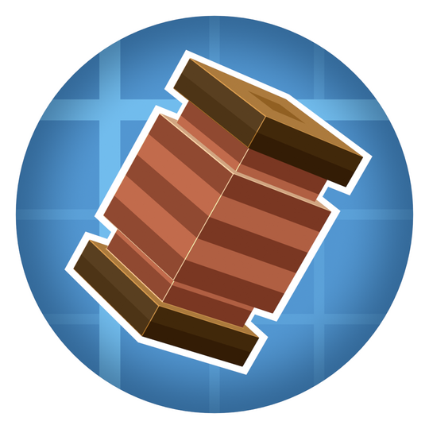

<div align="center">
  
  <h1>Create Fly: Electro Energetics</h1>
</div>

A Fabric 26.2 port of [Create: Electro Energetics](https://github.com/george8188625/Create-Electro-Energetics), built for [Create Fly](https://github.com/ZurrTum/Create-Fly).
Compitable & tested witch [Create Fly: Steam 'n' Rails](https://github.com/cat4blep/Create-Steam-n-Rails-Fly)

Electro Energetics simulates voltage, current, resistance and power losses. It adds electrical generation and distribution, motors, transformers, panels, meters, protection devices, lighting and electric railway equipment to Create.

Fabric Energy API 5.0.0 is bundled. CC:Tweaked 1.120.2 and JEI 30.42.0.236 for Fabric 26.2 are optional.

Install the built mod JAR on the client and server together with the required dependencies.

## Build

Use the checked-in Gradle wrapper with Java 25:

```sh
./gradlew build
```

On Windows:

```powershell
.\gradlew.bat build
```

The playable JAR is written to `build/libs/`. The `-sources.jar` is for development.

## Verification

The port passed a clean build, five JUnit tests, the dedicated-server GameTest suite, and real client rendering tests with and without CC:Tweaked/JEI. The server suite contains 23 CEE tests and Fabric's standard control test.

```sh
./gradlew runClientGameTest
./gradlew runGameTest runClientGameTest -PwithOptionalCompat
./gradlew runDatagen
```

Client tests need an OpenGL-capable display. On Linux, use `xvfb-run -a ./gradlew build runClientGameTest`. The GitHub workflow builds and tests with read-only repository permissions.

## Compatibility

The Fabric port includes the core electrical simulation, machines, wires, panels, Fabric Energy converter, Create contraptions, railway power, schematics, Ponder, client tools and optional CC:Tweaked/JEI integration.

Sable/Sable Companion, Aeronautics, Offroad, Simulated and Strut Your Stuff integrations require compatible upstream Fabric 26.2 releases. The unsupported assembly mixins and Strut block source/resources are retained under `src/unsupported` for further work.

CEE saved-data migration is covered by tests. Review an existing world upgrade using a copy; other mods in an old NeoForge modpack need their own compatible versions and migration.

## Documentation

- [Development and compatibility reference](FABRIC_PORT.md)
- [Changelog](CHANGELOG.md)
- [Contributing](CONTRIBUTING.md)
- [Manual publication instructions](PUBLISHING.md)
- [Historical upstream notes](docs/upstream/README.md)

## Credits and license

Original mod by George VI. This repository contains a Fabric/Create Fly port based on upstream commit `4828c3487a9fc0703717b415eb07d005c7a48653` from the `1.21.1` branch.

The original copyright notice is retained. Licensed under the [MIT License](LICENSE).
